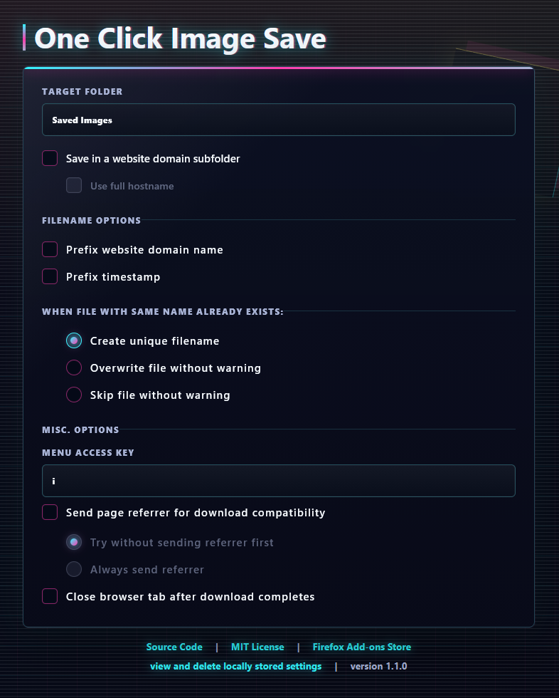

# One Click Image Save

A lightweight privacy-friendly Firefox extension that adds a **Save image** entry to the image context menu and downloads an image immediately, without opening the file picker.

Get it from Firefox Add-ons:
https://addons.mozilla.org/firefox/addon/one-click-image-save/

Source code:
https://github.com/wollomatic/one-click-image-save

One Click Image Save supports desktop Firefox 140 and newer.




## Features

- Right-click an image and select *Save image*
- Downloads start immediately without a save dialogue
- Configurable keyboard access key for the context menu entry
- Configurable target folder inside your Firefox downloads directory, or save directly to the downloads directory
- Optional website domain subfolders, with either registered domain or full hostname
- Optional filename prefixes based on website domain and timestamp
- Configurable handling for filename conflicts: create a unique name, overwrite, or skip
- Optional reduced page referrer for compatibility with image servers that require it, with a privacy-first retry mode
- Optional automatic tab closing after the download completes
- Support for HTTP, HTTPS, and `data:image/...` image URLs
- Transparent saved-settings view with one-click deletion
- No tracking, telemetry, or ads
- Fully open source

## Usage

1. Right-click an image.
2. Select **Save image** (either per mouse or keyboard shortcut).
3. The image is saved to the configured location inside your Firefox downloads directory.

Open the extension options page from the toolbar button or Firefox's add-ons manager to change the target folder, filename behaviour, conflict handling, and saved settings. Leave the target folder empty to save directly to Firefox's downloads directory. Backslashes are converted to forward slashes because Firefox expects download paths as relative paths such as `Saved Images/example.jpg`. Firefox does not allow a folder component to start or end with a dot, so these dots are removed automatically.

Reserved Windows device names such as `AUX.png` are prefixed with an underscore. When an image URL does not identify a supported image format, custom filenames remain extensionless rather than assuming JPEG.

Pending download metadata is kept in Firefox's in-memory session storage so completion handling and referrer retries survive background-page suspension. This metadata is removed when a download finishes, fails, or is removed from the download history, and is cleared when the browser session ends. Paused downloads remain pending until resumed or cancelled. Saved options continue to use local storage separately.

## Limitations

Due to Firefox extension restrictions, downloads can only be saved within Firefox's configured download directory.
Custom relative subfolders are supported, but arbitrary absolute filesystem paths are not.

The extension does not send a page referrer by default. If an image server rejects a download, the compatibility option can either try without a referrer first and retry rejected requests once with a reduced referrer, or always send the reduced referrer immediately. Credentials, query parameters, and fragments are removed, and cross-origin targets receive only the source website's origin. Enabling either mode reveals the source website to the image server when a referrer is sent.

To keep permissions to a minimum, the extension does not request access to cookies. As a result, saving some images from Firefox container tabs may not work, especially when a login is required. In these cases, use Firefox's built-in **Save Image As** action.

Firefox for Android is not supported.

## Changelog

#### Unreleased

* Restore pending download handling after background-page suspension, including tab closing and referrer retries.
* Keep paused downloads pending and release temporary image URLs only after completion, cancellation, or history removal.
* Sanitize Windows device names in filenames and target folders.
* Use neutral filenames for unknown HTTP image formats instead of assuming JPEG.

#### 1.1.2

* Recognise CDN image-size suffixes such as `.png:large` when choosing filenames, without changing download URLs.
* Recognise `image/x-png` data images and use neutral filenames without an assumed extension for unknown image MIME types, keeping image data out of filenames.
* Limit complete filenames, including prefixes, to 180 UTF-8 bytes while preserving image extensions and complete Unicode characters.
* Keep rapid option changes in order and prevent pending autosaves from restoring deleted settings.
* Stop waiting for downloads removed from the download history and release their event listeners.

#### 1.1.1 (unreleased)

* Prevent layout shifts when autosave status messages appear or disappear on the options page.
* Use shortened website domains by default for filename prefixes and subfolders, matching the options page.

#### 1.1.0

* Improve compatibility with some websites.
* Recognise additional image filename and MIME formats.
* Added selectable referrer compatibility modes: try without a referrer first, or always send it.
* Wait for downloads to complete before closing the source tab.
* Normalise folder names that Firefox rejects: leading and trailing dots are removed from every folder component.
* Transfer repository to GitHub because of Codeberg's changed Terms of Use.

#### 1.0.0

* Update and pin the development toolchain and resolve known dependency advisories.
* Stop logging URLs to the local browser console.
* Make referrer transmission opt-in.
* Explain the new privacy-first referrer default to existing users once after updating.
* Added support for saving directly to Firefox's downloads directory by leaving the target folder empty.
* Allowed dot-prefixed target folders such as `.images` for hidden directories on Linux (removed in v1.1.0).
* Clarified that backslashes in target folders are converted to forward slashes for Firefox download paths.
* Added unit tests for target-folder path normalisation and sanitation.

#### 0.3.2

* Improved filename and path sanitation.
* Excluded development-only files from packaged builds.

#### 0.3.1

* Improved compatibility with websites requiring a referrer.

#### 0.3.0

* Store only non-default settings.
* Added an option to delete all settings from browser storage.

#### 0.2.3

* First published release.

## Development

Install dependencies:

```bash
pnpm install
```

Run in Firefox:

```bash
pnpm run start
```

Run unit tests:

```bash
pnpm test
```

Or load manually:

1. Open `about:debugging`
2. Click **This Firefox**
3. Click **Load Temporary Add-on**
4. Select `manifest.json`

## Package

```bash
pnpm run build
```

This creates a ZIP file in `web-ext-artifacts/`.

## Permissions

- `contextMenus`: adds the right-click menu entry
- `downloads`: saves the selected image
- `storage`: stores only option values that differ from the defaults

## AI-Assisted Development

This repository was developed using a combination of manual engineering and AI-assisted tooling.

OpenAI Codex was used for tasks such as:
- Code generation
- Refactoring
- Documentation drafting
- Boilerplate creation

All generated output was reviewed and adapted as necessary. No AI-generated contribution is assumed to be correct, secure, or production-ready without human verification.
