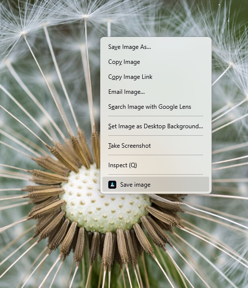
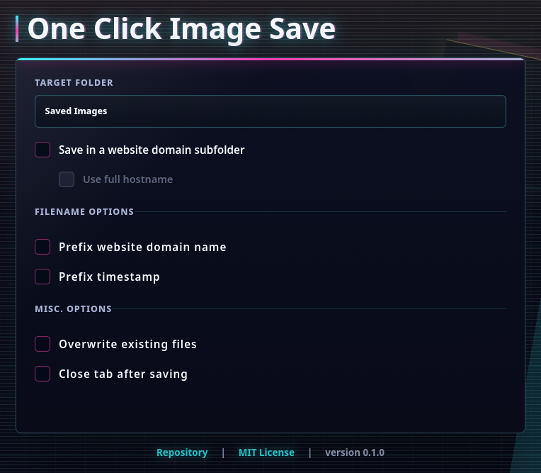

# One Click Image Save

A lightweight Firefox extension that adds a **Save image** entry to the image context menu and downloads images instantly without showing the file picker.





## Features

- No tracking, no telemetry, no ads
- Right-click an image and select *Save image*
- Downloads start immediately without a save dialog
- Configurable target folder inside your Firefox downloads directory
- Optional website-specific subfolders
- Optional filename prefixes based on timestamp or website domain
- Configurable handling for filename conflicts
- Optional automatic tab closing after the download starts
- Fully open source

### Limitation

Due to Firefox extension restrictions, downloads can only be saved within Firefox's configured download directory.
Custom subfolders are supported, but arbitrary absolute filesystem paths are not.

## Development

Install the helper:

```bash
npm install
```

Run in Firefox:

```bash
npm run start
```

Or load manually:

1. Open `about:debugging`
2. Click **This Firefox**
3. Click **Load Temporary Add-on**
4. Select `manifest.json`

## Package

```bash
npm run build
```

This creates a ZIP file in `web-ext-artifacts/`.

## Permissions

- `contextMenus`: adds the right-click menu entry
- `downloads`: saves the selected image
- `storage`: stores the configured target folder and options

## AI-Assisted Development

This repository was developed using a combination of manual engineering and AI-assisted tooling.

OpenAI Codex was used for tasks such as:
- Code generation
- Refactoring
- Documentation drafting
- Boilerplate creation

All generated output was reviewed and adapted as necessary. No AI-generated contribution is assumed to be correct, secure, or production-ready without human verification.
